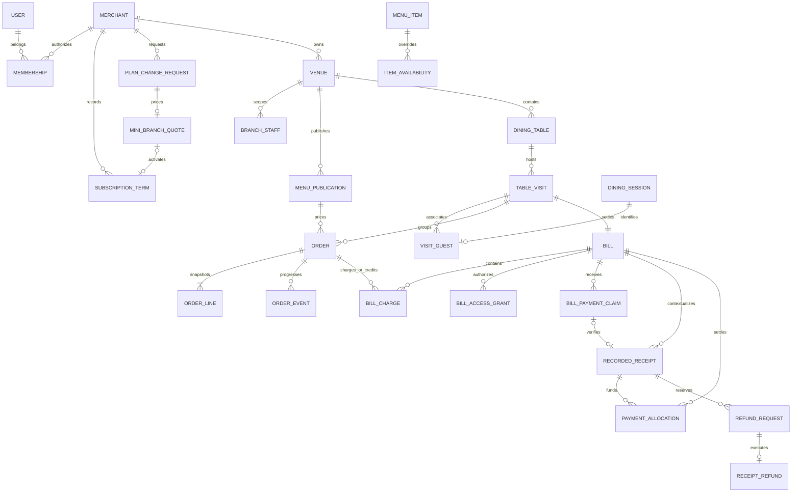

The current physical model is `MenuMini_1/database/migrations/0001_foundation.sql` followed by `0002_workflow.sql`, `0003_mini_two_branches.sql` `0004_phone_identity_fields.sql`, `0005_menu_publication.sql`, `0006_service_preparation.sql`, `0007_staff_service.sql`, `0008_cashier_settlement.sql` `0009_guest_ordering.sql` `0010_payer_claims.sql` and `0011_command_recovery.sql`. The second migration replaces the application's order-linked settlement path with visits, bills, receipts and allocations. See [workflow-foundation.md](workflow-foundation.md) for implemented rules, command coverage and remaining service work.

An accepted order is charged once. Corrections reference that order's remaining charge; cancellation does not credit earlier corrections again. Each visit has one bill in the initial implementation. Guest-origin orders require their own paired session, while staff-origin orders retain the responsible staff actor. Seating can end while its financial obligations remain open.

Receipts store actual money received. Allocations and explicit reversals determine bill settlement; refund requests reserve unapplied funds, while executed refunds record actual returns. Receipt identity is independent of a customer's claim and can exist without one, as with cash. A pending claim cannot establish paid state.

Free permits one active branch. MenuMini has a hard maximum of two; its second-branch capacity requires a price request, immutable quote, owner acceptance and verified subscription activation. Optional email is now represented alongside a unique canonical phone in the identity model; no verification or login adapter is implemented. Pro capacity is an explicit applied term, with scoped staff permissions; the commercial Pro maximum remains open. Draft catalog, immutable publications and live availability are separate records. Audit/outbox facts commit with financial changes, and runtime table writes are restricted to domain commands.

Operational links use business/branch-scoped foreign keys and RLS. Own-guest order reads, payer grants, staff branch scope and platform billing authority have separate checks. Trusted server session verification is still required; database context settings are not client authentication.

The second migration intentionally refuses populated v1 order/payment history. Provider-specific account normalization, trusted identity and persisted onboarding, production capability-key/QR delivery, supervised reconciliation, reporting/shift records, worker access and transaction HTTP/browser integration remain implementation work. The registration format validator has HTTP/browser evidence; local checks do not establish a live product or a production upgrade path.

Migration 0009 adds a hashed CSRF binding on anonymous sessions, durable technical guest request guards and a separate `menu_guest_api` role. That role has no table access or staff/runtime inheritance: narrow entry functions clear ambient context and resolve an opaque cookie before every operation. Table links never associate a guest with a visit; five-minute staff invitations do that. Guest order lists/reads are restricted to the resolved session, and ending a visit does not revoke still-valid own-order tracking. A new seating cannot reuse a session already bound to an earlier visit.

Migration 0010 adds versioned PAYER_V1 grants, own transfer-report timestamps and immutable reviewed destination snapshots. Narrow payer entry resolves both guest and bill cookies; shared bill projections omit private diner instructions and other payers references. New pending/approved claims and canonical receipts have conservative case-insensitive duplicate indexes; receiving destination/reference advisory locks serialize reporting and receipt creation across branches. These guards preserve original reference text and do not replace provider-specific normalization. Existing histories conflicting with the new indexes require reconciliation before applying the migration. Real merchant issuance remains closed until trusted identity is implemented.

Migration 0011 adds immutable, actor/branch/operation/key-scoped command cancellations. Status resolution and cancellation acquire the same branch lock as the original command and recheck current authority. A committed result is returned without reversing it; otherwise a cancellation prevents a delayed original request from recording. The runtime has no direct access to cancellation records. Browser pending bodies are encrypted in IndexedDB and remain separate from server financial facts. A missing result never proves a delayed request cannot arrive.
