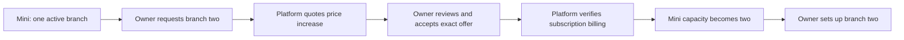

# Business registration, sign-in and setup

12 October 2026. Current user decisions: SvelteKit + TypeScript + PostgreSQL; Free / MenuMini / MenuPro; MenuMini has a hard maximum of **two active physical branches**. The second branch has a requested price increase while the business stays on MenuMini. The amount is undecided. Staff can accept unpaid orders; transfers require manual verification of credited funds. No pilot is secured yet.

## First-time registration

The requested detailed screen is **business registration**. Returning sign-in must not ask people to re-enter the business profile.

| First screen | Requirement and behavior |
|---|---|
| Name of the business | Required. Helper: “The same name used as in Business License.” Preserve Amharic and other Unicode names; trim surrounding whitespace. A public trading name can be different and is added later. No license verification badge follows from entering a name. |
| Type of business | Required selection from the actual 24 entries in `templates/index.json`. These determine starting menu sections. The six visual themes are a separate choice. Template metadata never enables unsupported inventory, delivery, age checks or calculations. |
| Full name of owner | Required; no artificial first-name/last-name split. |
| Owner’s phone | Required. Accept readable Ethiopian local or international input; store canonical international format once persistence is implemented. Format checks cannot prove the person controls a number. |
| Owner’s email | Optional. Leaving it blank must not block setup, login or owner approval. No invented placeholder email. |
| Full name and phone of administrator / general manager | Required when a separate person holds that role. “Owner is also the administrator / general manager” reuses the owner contact and avoids duplicate fields. |
| Manager’s email | Optional independently of the owner’s email. |
| Person completing setup | Owner or authorized administrator / general manager. If owner and manager are the same person, use Owner. Separate people need separate sign-in numbers. |
| Authority confirmation | Required confirmation that the registrant is authorized to set up the business and provide these contacts. This is a declaration; it is not legal ownership verification or a substitute for published terms/privacy notices before launch. |

Do not demand a bank account, card, TIN, license image, logo, table count, street coordinates or a paid plan on the first screen. Any business/payment evidence actually needed belongs to the relevant later review. A contact name and phone do not automatically create an account, membership, permission or invitation.

The first screen is grouped into business, owner, manager and your access. The mobile layout puts the form near the top. Errors stay beside the relevant field, and a failed request keeps the entries available for correction.

## What happens next, in order

| Stage | Inputs or action | Completion rule |
|---|---|---|
| 1. Review the details | Show business/type and private contacts; allow editing. Explain which person’s number will be verified. | Server validates fields and template ID. No business or access is created just because the form looks valid. |
| 2. Verify the registrant | Send a short-lived code to the owner’s number if the owner is registering; otherwise to the manager’s own number. Allow paste, correction of the number, bounded resend and a clear delivery failure state. | Real provider verification; codes are single-use, expire, have limited attempts and are never returned in API responses/logs. No universal demo code. This is phone possession, not license validation. |
| 3. Establish the business and authority | Owner-led: create a private setup workspace for the verified user after the declaration; invite a separate manager only after owner confirmation. Manager-led: verify the manager, then obtain owner phone verification and explicit approval of this business and this manager. | A manager cannot grant themselves ownership or activate business access. Draft preparation may be allowed privately while owner approval is pending. Entering another person’s phone never grants access to that person’s existing business. |
| 4. First branch | Public trading name if different, branch name, city/area, address or practical landmark, service mode and opening hours. A mobile/catering business can use its operating base/service area. Public customer phone is separate and optional; personal numbers are not automatically published. | Branch belongs to the verified business. Default ETB and Africa/Addis_Ababa are visible settings. Hours distinguish closed days and overnight service; a missing value must not appear as “open 24 hours.” |
| 5. Plan | Explain Free menu browsing, Mini operating features and maximum two branches, and the future Pro offer. Start with one branch. Display real approved prices before accepting a paid plan. | Only verified SaaS subscription billing activates paid capabilities. A restaurant customer’s payment cannot pay or activate its software subscription. No final prices have been selected. |
| 6. Menu draft | Start with the selected business type; edit sections/items and enter real prices, modifiers and availability. English/Amharic content and images can be added in stages. Choose a visual theme separately. | No sample products are silently published as real offerings. Unsupported template features remain unavailable. Confirm the actual tax/service-charge policy before operational order pricing. |
| 7. Preview and publish menu | Preview on a phone, confirm the public branch name/contact and item prices, publish a version, then generate the public menu QR/link. | A separate customer browser reads the committed publication. Draft edits do not alter the live menu until published. A Free menu can launch without ordering, staff invitations or receiving accounts. |
| 8. Prepare ordering, if wanted | Set up tables/service points, a responsible staff device, staff invitations and branch permissions. Confirm receiving accounts before displaying transfer instructions; provide the actual cash procedure when cash is enabled. | Invitations are accepted by verified people; permissions are explicit. Naming the administrator does not make them a platform administrator. Menu-only, counter and dine-in setup must not silently promise unsupported delivery or catering operations. |
| 9. Practice and activate orders | Run a test order, staff acceptance, preparation/service, unpaid bill, cash/verified transfer and reconciliation with fictional fixtures before field use. | End-to-end state survives reload and restart; QR links reach the correct branch; staff know who checks payments. Show separate “menu published” and “ordering ready” statuses. |
| 10. Everyday operation | Resume the appropriate branch dashboard, change availability, receive/accept orders, track preparation, verify receipts, resolve balances/refunds and close/reconcile. | New orders check subscription and branch capabilities. Existing financial obligations remain visible after expiry or downgrade. |

After verified registration, setup should resume from persisted progress; do not force users to repeat completed steps. Optional tasks should be skippable. A failed invitation must not destroy an owner’s workspace. A manager can decline an invitation, an owner can revoke access, and a changed number requires re-verification and a recovery process.

## Returning sign-in and recovery

Returning sign-in asks for **the person’s own verified phone number and a verification code**. Email stays optional. A session resumes unfinished setup or shows permitted businesses/branches; choosing a branch cannot grant access to it. The owner who is also the manager uses one identity.

Responses should not reveal whether an arbitrary phone has an account. Bound attempts/resends and abuse costs; implement secure session cookies, expiry, revocation, CSRF protection and logout. Subscription, receiving-account changes, role grants and account recovery need recent verification and a stronger recovery/step-up policy before launch. SMS availability and delivery cost in Ethiopia still need a chosen, verified provider; SMS is not an assumed high-assurance proof for every sensitive action. See the primary [OWASP authentication guidance](https://cheatsheetseries.owasp.org/cheatsheets/Authentication_Cheat_Sheet.html) and [MFA guidance](https://cheatsheetseries.owasp.org/cheatsheets/Multifactor_Authentication_Cheat_Sheet.html).

Do not recover ownership from a caller knowing the business name, an optional email, a screenshot or the manager’s number. Owner disputes and lost-number recovery require an explicit audited support procedure. Do not request the user’s real credentials or codes in this chat.

## Second branch while staying on MenuMini

The offer displays the current and new **all-inclusive recurring totals**, the same monthly/yearly interval, the immediate amount due (which may reflect proration), the entitlement dates and quote expiry. No automatic charge follows from requesting or accepting it. The price examples in tests are fictional. Accepted terms cannot be edited in place. An expired or changed offer needs a new request and consent.

The first branch keeps operating during the request. Quotes are private to the owner; staff cannot set prices or approve software billing. Activation must keep `plan=MINI`, set capacity two, and link the term to the accepted quote. A third active branch is rejected even under overlapping requests. It requires an appropriate Pro agreement later; raising the Mini price cannot bypass its hard ceiling. Archival must preserve history and must not be used to hide ongoing service or settlement obligations.

`0003_mini_two_branches.sql` implements the capacity checks and request/quote/accept/activate database commands with audit/outbox records. HTTP routes, billing reconciliation, cancellation/decline handling, renewal/change-of-term handling and the quote portal are still pending. Initial activation applies one quoted period once; this is not an automatic billing system. Existing price/evidence must be checked by the platform operator against actual billing records.

## Data ownership and implementation boundary

### Preparing setup while OTP is deferred

The user explicitly deferred actual OTP work. The registration review therefore has **Continue preparing setup**. It leaves verification pending and opens a preparation workflow; it does not bypass authentication or create a merchant. An exported preparation file can also be resumed directly from the first screen without re-entering private contacts.

The implemented sequence is first branch → plan preference → menu → checked review/customer preview. The branch collects the public name, branch name, city/area, address or landmark, a separate optional public phone, menu-only/dine-in/counter preparation and seven days of hours. ETB and Africa/Addis_Ababa are explicit fixed settings in this slice. Unspecified days remain unknown; closed days have no times. Overnight service requires an explicit next-day flag; equal opening/closing times do not silently mean 24 hours.

Free prepares one browsing-only menu. Mini prepares one branch initially and explains the quoted second branch, with its maximum of two. Pro records future interest only; its commercial terms/capacity remain undecided. A preference cannot purchase, quote or activate an entitlement. Receiving accounts and personal contacts are not demanded to prepare a menu.

The selected business type supplies only its actual starting section names. All 24 structures are covered. Template sample options, price modifiers and operational features are excluded from this import. Users can rename/add/remove sections and items, add optional Amharic names/descriptions, enter explicit ETB prices and mark availability. Prices normalize decimal text without floating-point rounding; the server accepts exact two-decimal strings. Zero price is accepted only when entered explicitly. This preparation editor has limits of 30 sections, 50 items per section and 200 items in total; these are draft-size limits, not finalized commercial allowances.

The six visual themes are separate from business type. Preview shows populated sections, unavailable items, public branch details and supplied hours. It has no cart/order controls. The review lists remaining launch work: phone verification, business authority, publication, paid subscription activation when needed, and ordering setup when requested. Publishing stays disabled. A checked empty menu is still a valid preparation draft and has a separate launch blocker.

Work remains in page memory unless the user explicitly exports `menumini-setup-draft.json`. The file contains only a versioned preparation structure: business type, public branch details, plan preference and menu. It excludes the legal registration profile, owner/manager names, personal phones/emails, authority declarations, sessions and entitlement assertions. The importer checks the local format and the actual server validator before replacing a draft, and asks before replacing existing preparation. Invalid imports preserve the current draft. Reload clears the page, then importing the file resumes preparation; this is portable draft recovery, not authenticated server persistence. Imports cannot grant account access or publish anything.

`/api/v2/onboarding/setup-validation` enforces same-origin JSON, a 256 KB streamed limit, strict nested fields, canonical money, distinct IDs, hour consistency and item limits. It returns counts and pending launch blockers with no-store headers, never the submitted draft, a session or any created resource. It is stateless, so safe retry needs no idempotency key. Both validation routes share bounded transport handling; neither contacts a provider or database.

Identity is global to a person; optional emails and unique canonical phone fields are represented in `0004_phone_identity_fields.sql`. `phone_verified_at` must be set only by the future trusted identity adapter. A database field is not a working login system.

Persisted onboarding will require separate records for the private registration draft/progress, business profile and chosen template, contact roles, verification challenges, expiring invitation/approval capabilities and business/branch memberships. Contact records are not identities. If the same person is owner and manager, one identity can hold both responsibilities without duplicate phone accounts. Public branch contact settings are separate from all of these. Existing membership/branch-staff tables remain the authority for operating access.

The current implementation provides:

- `/onboarding`: the requested first screen, server-backed field checking, a private review, and working branch/plan/menu preparation with customer preview and explicit draft export/import. It is explicitly a preview.
- `/api/v2/onboarding/validation`: real stateless validation, strict fields, same-origin checks, a 16 KB body limit, structured errors and no-store responses. It does not echo contacts, set a cookie, send SMS or write a business.
- `/api/v2/onboarding/setup-validation`: real stateless preparation validation, strict nested fields, a 256 KB body limit, exact prices/hours/size checks and truthful launch blockers.
- `/sign-in`: a clearly unavailable phone-sign-in preview until the identity adapter exists.
- The actual 24-type registry, two-branch database rules, quote lifecycle commands, optional-email identity fields and updated Postman contracts.

The preview holds entries only in page memory; reload clears them. Explicit export/import preserves only preparation data. It deliberately does not put private contact data in localStorage, URLs or the service-worker cache. This is not the final authenticated resumable onboarding experience. The worker now caches only public shell/assets and drops its earlier MenuMini cache. Production infrastructure must also honor no-store and avoid request-body logging.

The persistent menu foundation is now implemented and tested separately from unverified setup; see [menu-publication-design.md](menu-publication-design.md). The shared preparation mapper preserves the menu data and excludes contacts/plan activation. A local fictional customer site reads actual committed PostgreSQL publications and generates its menu QR; ordinary preparation still cannot publish or save into a real account. The setup review now continues directly into the merchant workspace without copying registration contacts. It supports bilingual descriptions, item options, planned table labels, staff duties and cash/manual-transfer preparation. Workspace download/import preserves these fields; it remains preparation on the page. Private service drafts and readiness are tested through server adapters separately from unverified setup; see [merchant-workspace-design.md](merchant-workspace-design.md). Authenticated editing still needs the later authentication/provider adapter, verification/recovery policy, trusted sessions, owner approval, invitations and persisted onboarding progress. Validate two independent authenticated/guest browser sessions before wiring orders and payment settlement. [SvelteKit’s form/server guidance](https://svelte.dev/docs/kit/form-actions) informs the server boundary; stateful mutations need the existing authenticated command pattern.
