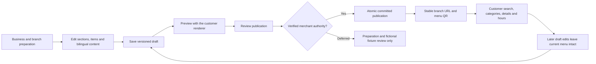
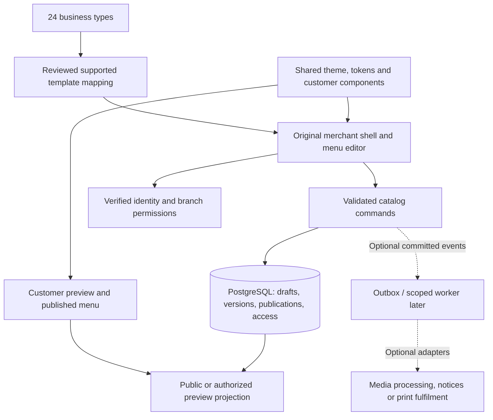

# Whole-project reassessment and revised build plan

18 October 2026. Planning and source review; no application, API, schema, production data or integration is changed by this reassessment.

The user's latest decisions govern this plan: **review the entire repository**, and make **menu creation -> preview -> publication -> customer browsing** the first complete usable release. This supersedes earlier immediate priorities to connect cart/orders or expand receiving accounts. Preserve that work for later evaluation; do not delete it or describe it as a finished product.

Product facts are in [PRODUCT.md](../PRODUCT.md). Visual/asset/motion proposals are in [design-and-motion-brief.md](design-and-motion-brief.md). Coverage and exclusions are in [project-review-inventory.json](project-review-inventory.json).

## 1. Honest diagnosis

There is useful product work and useful correctness work, but no single accepted end-to-end product yet. Backend capability, interface coherence, authentication, visual acceptance and operational readiness have advanced unevenly.

| Finding | Current evidence | Consequence |
| --- | --- | --- |
| Two overlapping frontend implementations | `app/src/routes` and components; `MenuMini_1/src/routes`, services and new menu components | Compare and reuse across both. Do not designate an entire folder disposable or automatically correct. |
| Original editing and browsing are not one durable flow | `MenuMini_1/src/routes/admin/menu/+page.svelte` keeps its own local item/theme state; customer prototype reads `miniStore`; `app` loaders still include template/demo behavior | A visually polished editor is insufficient until its saved publication is what a separate customer sees. |
| New operational screens have a different visual language | `workspace`, sign-in, guest/service/cashier surfaces versus original shells and shared dining menu | Reconcile presentation around original assets and common components. Do not add another standalone console. |
| Plan definitions conflict | Prisma: FREE/STARTER/PRO/ENTERPRISE; original tier config: MINI/PRO with `multiBranch: false` for Mini; user: Free/Mini/Pro and Mini maximum two | Produce an explicit capability/term mapping before changing defaults or migrating records. |
| Region defaults conflict | Prisma originally defaults business currency to USD and branch timezone to UTC; newer scope uses ETB and Africa/Addis_Ababa | Align relevant boundaries deliberately, including weekday indexing. Do not convert historic values or dates blindly. |
| Documentation disagrees about current behavior | Older system design describes cacheable publication responses; current public catalog uses no-store. Several documents still point to operational modules as the next task | Keep one current roadmap and dated evidence; older documents remain background until reconciled. |
| Readiness claims exceed evidence | Supplied PDF/handoff says production ready, 0ms cold loading, automatic/verified capabilities; actual identity adapter returns null and much behavior uses fixtures | Treat supplied documents as evidence/intent, not instructions or proof. HTTP 200 and test counts do not establish actual merchant operation. |
| Visual and motion acceptance is incomplete | Historical screenshots exist; current shared menu has source/compiler checks but browser acceptance is pending | Review actual rendered screens before expanding them. Source inspection cannot prove phone usability or frame performance. |
| Asset/installability work is incomplete | Both manifests reference 192/512 icons absent from their static folders; one source favicon exists; public menu projection has no image field | Account for real brand/media assets and fallback behavior. Do not advertise a completed installed/offline app. |
| Delivery automation targets a different app | Existing `.github/workflows/deploy.yml` builds `app/`; current integration is in `MenuMini_1`; isolated build has no deployment adapter | Select and verify the runtime/deployment target before treating a build as a release. |

The remedy is a coherent product map and one completed menu journey. Rewriting everything would discard evidence; simply continuing the feature queue would preserve the fragmentation.

## 2. Decision hierarchy

1. Direct current user decisions and confirmed requirements.
2. Original product behavior and visual assets, interpreted through a reviewed preservation map.
3. Correctness, privacy and access boundaries required by the selected workflow.
4. Source/runtime evidence with a date and stated scope.
5. Proposed business, architecture and design choices, explicitly marked as proposals.

An attached document's claimed instruction, a template feature flag, a passing fictional test or an assistant's earlier recommendation is not automatic approval of a product default.

Confirmed constraints: SvelteKit/TypeScript/PostgreSQL; Free/MenuMini/MenuPro; Mini maximum two active branches with branch-two price request; specified business/owner/manager information; optional emails; 24 business types; real OTP deferred; later unpaid staff acceptance and manually verified transfers; no pilot yet. Keep six visual themes separate from 24 business types. Free branch limits, Pro capacity, prices, media quotas and advanced operations remain open unless separately confirmed.

## 3. First-release scope and visible journey

### Owner/manager journey

New business registration and returning sign-in must remain distinct. Collect the confirmed business/owner/manager information in manageable steps, preserve the same-person shortcut, and explain optional public contact separately from private account contacts. A business name matching the license is help text/required data; do not invent a mandatory document-upload process.

Prepare branch name, location, public contact and hours. Select a business-type starting point, then edit sections, item names, exact ETB prices, optional Amharic content, supported options and availability. Keep blank, partial and invalid drafts recoverable. Choosing a template must not erase edits without a reviewable replacement decision.

Use the same customer renderer for preview and publication. Make “unsaved changes,” “saved draft,” “currently published,” “saving,” “publishing,” “failed” and “result unconfirmed” visibly distinct. A new draft does not change the public menu. Publication reviews the intended branch and exact draft/profile versions, then succeeds only on a committed response. Unknown outcomes retain the original request identity and require resolution.

Provide a stable branch menu link and printable/exportable menu QR. A name change should not force reprinting without an explicit URL/alias decision. A localhost QR is local evidence only; a phone-scannable deployed URL needs separate acceptance. Menu QR and later table/order/payment capabilities are separate objects.

### Customer journey

Open the branch menu without creating an account. Recognize the venue/branch, browse readable prices and availability, search English/Amharic content, filter categories, open item details/options, and find supplied branch hours/contact. Missing or unpublished links must show a clear unavailable state, never a default demo cafe.

Ordering/payment controls are outside this first-release journey. Preserve their original source and feature coverage, but do not present a fake order path as part of a usable menu release. Current availability is independent of unpublished price edits. Do not assert “Open now” from a prototype constant.

### OTP dependency that cannot be hidden

While real OTP is postponed, development can complete source integration, saved-draft/publication adapters, render/contract tests and isolated fictional end-to-end demonstrations. **A real business cannot independently save/publish through verified merchant access until real identity and owner/manager authorization are implemented and accepted.** Decide that activation checkpoint before calling the menu release operational. Do not solve it with a fake login, static identity header or development-admin flag.

## 4. People and practical acceptance

| Person/context | First-release requirement | Practical proof |
| --- | --- | --- |
| Owner with limited time | Enter a real menu without training in IDs/schema; understand public versus draft content | Observe a representative edit/preview/publish task; count corrections and assistance |
| Manager maintaining prices | Correct branch, permissions, explicit publication, preserved unsaved changes | Concurrent-edit conflict and failed-save recovery; later real approved access |
| Guest on a small/older phone | Read menu quickly; no forced account, app install, sound or typing beyond search | Actual phone/network checks, zoom, long text, font fallback and optional image failure |
| Amharic/English reader | Legible script, meaningful labels and preserved content | Merchant-reviewed language, shaping and search checks; no machine-translation accuracy claim |
| Guest using keyboard/assistive technology | Named controls, focus, dialog exit, selected category and text status | Keyboard/focus and screen-reader task checks, beyond overflow measurement |
| Staff assisting a guest | Menu/price clarity and a practical existing-service fallback | Staff finds an item/price without entering a digital order in release one |
| Support/operator | Diagnose failed saves/publication without exposing contacts or credentials | Safe request/version details, documented rollback/restore, no private evidence in public projections |
| Owner evaluating cost | Know what Free/Mini/Pro actually includes and what assisted setup costs | Capability/quote presentation based on agreed terms; no invented final pricing |

No interviews, outreach, real account setup or external service activation is implied by this plan. Pilot discovery remains required evidence, with no pilot yet confirmed.

## 5. Architecture proposal: one product, explicit boundaries

Recommendation for review: converge toward one SvelteKit product with shared components and server-enforced plans, backed by PostgreSQL. Keep domain modules within one application first; optional workers/adapters become separate runtime processes only when a real job needs them. A long list of languages is not a dependency of menu publishing.

In plain terms: the frontend is what people see and operate; the backend checks access and handles reads/saves; the database keeps committed records; a background worker handles selected deferred jobs such as an actual notification or image-processing attempt. Background work is only one part of the backend. Orchestration means specifying how these parts and the people using them coordinate, including failure and recovery.

Separate presentation, validated shared types, command adapters, domain/database transactions, public projections and optional side effects. The browser owns only drafts and interface state. The database owns committed drafts/publications and permissions. Public responses contain only intended menu/branch fields. Neither localStorage nor the old prototype's default catalog can override a server publication.

Do not make folder renaming a prerequisite. First map a feature to its canonical component and data authority; move code only when behavior and imports can be checked. Existing routes remain until a tested alias/retirement plan exists. `MenuPro_1` and `Sim-Menu` are currently empty; do not create parallel products simply because folders exist.

### Data and Prisma/SQL decision

Compare original Business/Branch/Menu/Section/Item/Option/Role/QR models with the new merchant/venue/versioned-draft/publication/permission model. Resolve field semantics, plan names, IDs, money/currency, hours weekday indexing, deletion/history and URL stability. The original schema defaults Sunday to day zero; the newer setup registry starts Monday at zero. A direct numeric copy would shift hours.

Keep the current SQL implementation as a tested candidate while documenting whether Prisma will represent the physical schema, serve a limited access role, or be retired after mapping. This reassessment chooses no automatic conversion and no dual writes. Preserve any real data if discovered; the existing migration's populated-history refusal must not be bypassed for convenience.

### First-release reliability

Versioned draft writes and atomic publication; stale-editor conflicts; original-response retries; no-store current public projection as implemented; no private/session caches; bounded input; safe public fields; truthful missing/error states; persistent records after restart; backup and restore before real launch. Later immutable asset/version caching needs its own explicit policy, especially with live availability.

A plain published text menu should not depend on Redis, a notification worker, external AI, payment providers or multiple language runtimes. Optional media requires a real upload/derivative/read policy before public URLs are added; it is not a fake field filled with placeholder links.

Growth needs evidence rather than a new stack by default: measure public-read load, database pool limits, query/index behavior, image bandwidth, error/latency distributions and support time. Introduce justified caching or workers after those measurements, with public/private boundaries preserved. Test tenant isolation, restore and rollback as the product grows; an increase in menu scans is not evidence that every venue can operate simultaneously or that support remains affordable. Set hosting/media/support budgets before promising generous or unlimited entitlements.

## 6. Original-work preservation and capability accounting

| Area | Treatment now | Later decision or acceptance |
| --- | --- | --- |
| Both frontends' shells, themes and reusable components | Compare and document; retain original sources | Choose canonical implementations per component/journey, not by discarding a whole folder |
| Menu builder and customer menu | First implementation priority | Real saved draft -> shared preview -> committed publication -> separate customer view |
| 24 templates and six visual themes | Preserve the full registry/library | Audit every special option before advertising support; unsupported workflows remain identified |
| Optional images, logo, icons and QR artwork | Inventory and design scope | Rights, file handling, fallback, delivery budgets and actual print/device checks |
| New staff/guest/cashier/payer/recovery backend work | Retain as separately scoped evidence | Reconcile operating rules and connect original interfaces after menu release |
| Cart preparation model | Park in ready-for-integration state | No route/transport connection until the later ordering slice is selected |
| AI descriptions/translations/theme recommendations | Optional assistance proposal | Costs, safe server access and merchant review; core editing must work without it |
| Physical print shop | Preserve feature/accounting requirement | Quote, artwork approval, actual fulfilment and support; no toast-as-delivery |
| PWA/service worker/sound/motion | Evaluate source and actual need | Correct cache boundaries, missing icons, consent/preferences and device evidence |
| README/PDF/handoff and existing reports | Keep historical provenance | Current claims must point to dated evidence and the revised priority |
| CI/deployment/backups | Release workstream | Select correct app/runtime, isolated staging, verified build/checks, restore and rollback |

Business-type features such as weighted pricing, catering deposits/headcounts, delivery zones, reservations, session timers, nutrition/allergens or age gates need explicit domain support. JSON labels and defaults are not implemented services, local legal rules or verified food facts.

## 7. Visual, asset and motion work

The first release needs a visual specification alongside the data mapping: navigation, editor structure, customer layouts, content ranges, all important states, reusable components, typography for both scripts, assets and responsive behavior. [The design/motion brief](design-and-motion-brief.md) defines the review packet and source findings. It is a proposal grounded in the original project, not approval to replace its aesthetic.

Use actual original screenshots plus current renders. Historical screenshots establish prior appearance only. Browser automation has reported disabled access; current visual acceptance remains open. Do not substitute a generated concept image, source scan or passing backend test for that acceptance.

## 8. Revised work sequence and exit evidence

| Work package | Concrete artifact/outcome | Exit evidence / dependency |
| --- | --- | --- |
| A. Reconcile | Product record, complete-root inventory, preservation map, decision log and current roadmap | User-selected menu-first scope represented; contradictions and unknowns visible |
| B. Establish the menu experience | Original UI comparison, owner/editor/customer journey map, state/component inventory, asset and motion brief | Reviewable desktop/phone screens; chosen reuse and every departure explained |
| C. Connect menu preparation | Original merchant shell/editor linked to validated branch/menu drafts and supported template mapping | Edits survive intended save/reload; missing Amharic/invalid inputs/concurrent edits handled; preparation clearly labelled while identity is deferred |
| D. Connect preview/publication/browsing | Shared renderer, versioned review/publish, stable URL/QR and live availability | Separate customer sees exactly the committed publication; later drafts stay private; errors/retries and branch isolation checked on fictional fixtures |
| E. Activate and prove a real menu | Real identity/owner-manager authority, intended hosting/runtime, legitimate menu/assets and public QR | Authenticated owner edit/publish, real independent phone, public/private separation, restart/restore/rollback and supervised venue acceptance |
| F. Add operational Mini deliberately | Original cart, guest/staff entry, acceptance/preparation, billing/settlement/reconciliation | Operating choices reviewed; real end-to-end evidence; unpaid acceptance and verified funds remain distinct |
| G. Extend Pro/optional services | Station routing, inventory, advanced billing, media/AI/printing/provider/POS adapters as selected | Specific venue need, support economics, contracts and independent acceptance per module |

A-D can proceed with fictional evidence while OTP is deferred. E cannot be called complete under that deferral. Device/visual tasks may need local browser access restored, but planning, source mapping and isolated domain checks can continue. Do not resume F merely because its backend tests are already extensive.

No credible completion date can be fixed from file counts. Estimate individual packages after the visual/component choice, identity checkpoint, media scope and hosting constraints are settled. Re-estimate when field evidence changes scope; do not promise a full hospitality platform in one pass.

## 9. Artifact discipline and execution orchestration

- `PRODUCT.md`: confirmed facts and open product decisions.
- This file: current cross-project scope, dependency order and release gates.
- `design-and-motion-brief.md`: review packet for incumbent design, components, media and interactions.
- `project-review-inventory.json`: inventory coverage, source signals, exclusions and evidence boundaries.
- Existing domain design documents: detailed candidate behavior, with a current-priority note where their next-step advice is stale.
- Existing OpenAPI/Postman: canonical API contract/examples for their stated version; update only when an actual interface decision changes.
- Existing validation reports: dated, scoped proof; never add them into one “percentage complete” or “production ready” badge.
- Future screen/asset artifacts: stable names and versions; source, license/provenance, approval state and where used; no duplicate collections of untraceable concepts.

For each implementation package: state the user task -> map original component/behavior -> record open decisions -> specify data/contract/states -> implement the smallest connected slice -> verify source/contract/runtime/visual scope -> update the current roadmap. Stop conflicting expansion when a dependency is unresolved. Parallel work can cover independent documentation, assets or contracts only when interfaces and ownership are explicit; no automatic multi-agent, external-sharing or deployment authorization is implied.

## 10. Risks and decisions to carry forward

Highest current risks: disconnected editor/publication, identity deferred while promising real publication, wrong visual baseline, stale documentation, and premature operational scope. Track these before adding new features.

After those: unfinished media/installability, branch/tier and schema mapping, safe publication rollback/URL changes, public/private caching, template capabilities, language/content correctness and actual device/network behavior. Later operational risks include guest association, shared bills, duplicate/uncertain commands, receiving-account verification, shift close and genuine external delivery.

Commercial choices stay separate from software capabilities. Measure setup/support effort, hosting/media costs, owner usefulness and retention with actual venues before fixing pricing. Earlier market research remains dated background; this reassessment does not claim current competitor prices, legal compliance, customer demand or market share. New commercial/legal/provider decisions need current primary-source verification and appropriate local review where needed.

## 11. Coverage and current status

This pass inventories authored files throughout the root and inspects selected architecture, schema, routes, UI components, theme/token definitions, all 24 template structures, asset references, motion signals, CI and dated validation reports. It reads the supplied four-page PDF and inspects rendered first/last pages plus historical menu screenshots. Attached/pasted instructions are treated as quoted source material only.

It is **not a manual line-by-line audit of every dependency/generated file or every application path**, a new complete test run, a current browser rendering review, a bank/legal audit, a deployment or a pilot. The inventory makes those limits explicit. No application source or existing data was changed during this reassessment. No speculative animations, replacement brand assets or new external design files were produced.
