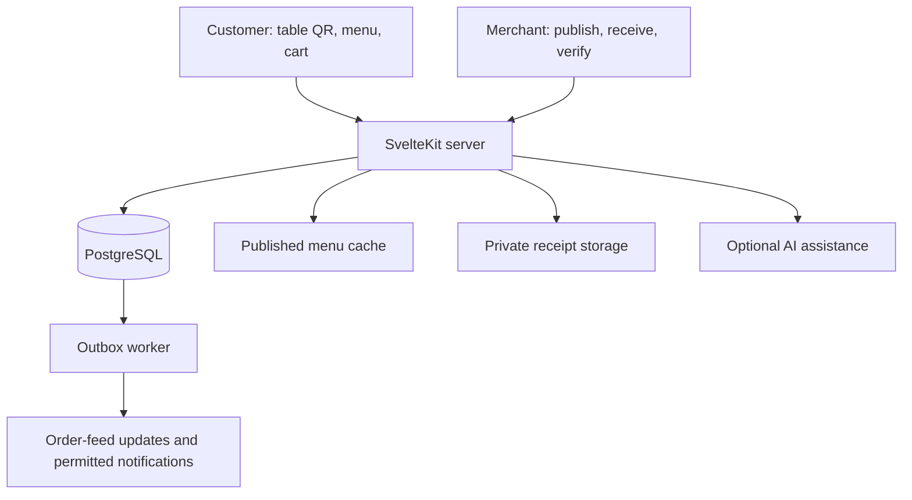

**MenuMini foundation: one SvelteKit/TypeScript application, PostgreSQL transaction records, and separate order and payment state.**

**18 October current-direction note:** [Project reassessment](project-reassessment.md) is the current whole-project roadmap, with menu creation/publication/browsing first. This earlier architecture proposal contains superseded assumptions: current public catalog responses use no-store, not the cacheable/ETag behavior described below. Prisma/SQL mapping, original UI convergence and real identity/publication remain explicit review/acceptance work. No existing data migration is authorized by retaining this proposal.

Status: initial design and database foundation. These files do not make the existing demonstration commercially complete. The user selected this stack and manual transfer verification on 12 October 2026. Staff may accept and prepare orders before payment is verified.

The [system and workflow orchestration](system-orchestration.md) describes the whole-product target across Free / Mini / Pro. [Workflow foundation](workflow-foundation.md) records the current migration and v2 contract for visits, combined bills, receipts, allocations and scoped permissions, with tested database behavior and remaining service work. The original v1 contract is historical; checkout must use the current bill model.

MenuMini supports a maximum of two active physical branches per business. The first connects initially; a second-branch price request, owner consent and verified subscription billing activate capacity two while keeping MenuMini. The workflow database also represents explicitly bounded Pro branches and assigned staff. Existing app/ remains a reference prototype; MenuMini_1/ is the product application. Its current customer/admin screens will be connected to this foundation in stages.



PostgreSQL decides whether an order exists, what it costs, who can access it, and which payments were recorded. The browser stores an editable cart and a previously published menu for continuity. A saved cart is a draft. “Order received” appears only after the server commits the order. Opening WhatsApp creates a message draft; a delivery claim requires actual delivery evidence.

| Module | Responsibility | First release |
| --- | --- | --- |
| Identity | Registration/login, opaque staff sessions, revocation, owner/operator membership | Required |
| Merchants | Account, one venue, local settings, public slug and ownership | Required |
| Catalog | Draft sections/items/modifiers; validated immutable menu publication | Required |
| Dining | Revocable table tokens; scoped guest session; no compulsory customer registration | Required |
| Orders | Server price calculation, idempotent creation, order feed, allowed status transitions | Required |
| Payments | Merchant receiving accounts, customer claims, authenticated manual verification, immutable receipts/refunds | Required |
| Reporting | Actual orders and payment records, CSV export with formula neutralization | Required after the transaction path |
| Jobs | Transactional outbox; bounded retries; duplicate-tolerant processing | Required for asynchronous work |
| Media | Menu images and private receipt assets; validated uploads; signed private downloads | Add when uploads are introduced |
| AI | Authenticated/rate-limited copy and theme suggestions; merchant review | Optional, after the transaction path |
| Printing | Durable print requests, quotation and internal fulfilment states | Later MenuMini milestone |
| MenuPro | Multiple venues, station KDS, expanded roles, inventory and split bills | Later product extension |

**The first working example is deliberately concrete.** An owner publishes a 70.00 ETB macchiato. A customer scans Table 4, selects two coffees, and submits. The server resolves the venue/table/session, checks the currently published menu and availability, validates modifiers, calculates 140.00 ETB, and commits order, lines, event, and outbox entry together. A retried request returns that same order. Staff can accept it immediately. A customer-provided bank reference creates a pending claim. An operator checks actual credited funds in the merchant's bank/telebirr records and records verification; only that receipt changes the calculated payment balance. A screenshot or AI interpretation alone cannot establish payment.

Order progress: SUBMITTED -> ACCEPTED -> PREPARING -> READY -> COMPLETED, with direct ACCEPTED -> COMPLETED for simple service and explicit cancellation paths. Accepted orders contribute to one visit bill. Settlement is derived as UNPAID, PARTIALLY_PAID, PAID or NO_PAYMENT_DUE, with unapplied funds and refund obligations shown separately. Actual receipt amounts and allocations are distinct; a partial transfer leaves a balance and an overpayment remains unapplied. Completing service does not imply settlement. The v1 full-balance/order-ledger rule is superseded.

The UI shows two independent indicators: “Accepted / preparing / ready” and “Unpaid / verification pending / paid”. Each action gets a truthful failure state: invalid table, closed ordering, item unavailable, price changed, rejected payment claim, connection lost, and retry pending. No automatic success timers remain once a screen is connected.

**Data ownership and integrity.** Every operational row carries merchant_id and venue_id where appropriate. Composite foreign keys keep related rows in the same merchant and venue. PostgreSQL row security provides a second tenant boundary under a non-owner runtime role. The server supplies transaction-local merchant context after authentication or trusted QR/session resolution. Staff permissions and guest ownership filters are also required: tenant RLS alone does not distinguish two customers at the same venue. Users never connect to PostgreSQL directly. The runtime role has no schema-changing or superuser privileges. [PostgreSQL documents both composite constraints](https://www.postgresql.org/docs/18/ddl-constraints.html) and [row-security behavior](https://www.postgresql.org/docs/18/ddl-rowsecurity.html).

Money uses exact PostgreSQL numeric(12,2) values and decimal strings in JSON. TypeScript uses an exact decimal implementation or integer minor-unit arithmetic for calculation, never binary floating-point billing. ETB is the initial currency; taxes/service charges are explicit venue configuration reviewed by the merchant, with no automatic hardcoded 15% rule. Currency conversion and country-specific tax automation are outside this version.

Receiving-account identity is registered in its canonical provider format after ownership checks. Receipt records snapshot that identity, and the unique transfer key uses provider, canonical receiving account and the bank reference across the platform, including merchants that share an account. Provider-specific alias normalization and reference interpretation must be verified during account onboarding; a customer-provided spelling is not the verification authority.

Published menus are immutable, versioned public snapshots derived from normalized draft tables. Editing the draft does not change an already committed order. An order retains names, chosen options, prices, table label and menu version from submission. Sealing the order and a deferred database check prevent committing an empty/partial order or a mismatch between order totals and its lines. Financial fields, sealed lines and recorded receipts cannot be rewritten; corrections use linked credits, allocation reversals and executed-refund records.

| Data family | Tables |
| --- | --- |
| Identity and merchant | app_users, staff_sessions, merchants, merchant_memberships, venues |
| QR and public routing | dining_tables, venue_routes, dining_sessions |
| Catalog and assets | media_assets, menu_sections, menu_items, modifier_groups, modifier_choices, menu_publications |
| Orders | orders, order_lines, order_events |
| Plans and staff scope | subscription_terms, plan_change_requests, platform_operators, branch_staff |
| Visits and bills | table_visits, visit_guests, bills, bill_charges, bill_access_grants |
| Payments | payment_accounts, venue_payment_accounts, bill_payment_claims, recorded_receipts, payment_allocations, refund_requests, receipt_refunds |
| Reliability and evidence | outbox_events, audit_events |

MenuMini enforces at most two active branches, with the second requiring a quoted and accepted price increase plus platform billing activation. Capacity checks lock the business. Pro uses an explicitly applied capacity and branch permissions; its commercial maximum remains undecided. The 24 existing business definitions are imported as editable starting sections and supported modifiers; their feature flags do not enable unimplemented calculators, age checks, or inventory systems. Unsupported features are clearly identified during template setup. The six visual themes are separate presentation settings, not business/data schemas.

**Request and transaction rules.** API routes are thin: parse/validate input, establish a principal, call one domain service, and format the response. The browser supplies item IDs, option IDs, quantities and a menu version; it cannot supply authoritative prices, paid state, merchant identity, or staff identity. Order and payment commands have idempotency keys and canonical request fingerprints. Reusing a key with a different request is a conflict. Status changes use an expected version to prevent one operator overwriting another. Initial workflow commands serialize changes within a branch after acquiring a business share lock; plan/capacity changes acquire a business update lock. Events/outbox records commit atomically, and external calls happen outside those transactions. [PostgreSQL's locking documentation](https://www.postgresql.org/docs/18/explicit-locking.html) is the concurrency reference.

Merchant authentication uses a maintained authentication library with PostgreSQL-backed sessions. The exact library is selected during the identity milestone rather than improvising password/OTP cryptography here. The staff session cookie is HttpOnly, Secure in production, and SameSite; unsafe browser requests require origin/CSRF checks. Guest dining sessions use separate random capability tokens, stored as hashes, limited to their venue/table and expiry. Order access is limited to the authenticated staff scope or the owning guest session. QR tokens identify a table, not a verified customer's physical presence; rate limits and staff acceptance are needed to handle remote/shared QR abuse.

The public venue directory is a deliberately small projection used to resolve a slug before tenant context exists. It contains no staff, customer, session, receipt or banking secrets. Publication responses are cacheable with a version/ETag. Staff pages, order/payment APIs, receipts and session-bearing responses use no-store and are excluded from service-worker caches. A revoked table token stops new dining sessions; existing-session policy is enforced server-side.

Guest-session creation reuses a valid cookie for the same venue/table on reload; changing the table/venue starts an explicitly different dining context. Never silently retry an old order using a newly created guest session. Version one supports one active dining context per browser profile; simultaneous unrelated venue tabs and capability recovery need explicit UX before they are advertised. Original QR artwork is stored privately for owner reprinting; a missing original requires issuing and printing a new revocable token.

Offline ordering saves a draft and an explicit “not submitted” state. It does not confirm orders offline. On reconnection, the client reloads current availability/prices and sends the same idempotency key only when retrying the same submission. It clears the draft only after a durable server response. Unfinished retries and changed prices remain visible to the customer. Receipt submission and verification require the server.

A database outbox carries IDs and event types, with processing leases, bounded retries and a dead-letter state. The v2 interactive runtime cannot read or mutate this queue; a separately scoped worker role/lease command remains to be implemented. Workers claim due events using row locks/SKIP LOCKED and use stable event IDs for idempotency. The merchant feed can read orders directly even if notification processing is delayed. Version one uses conditional polling for status updates; real-time streams are added when actual workload warrants them. Redis, separate Go/Rust services and WebAssembly are not prerequisites for a correct first transaction.

**Project structure to implement.**

```text
MenuMini_1/
  database/
    migrations/0001_foundation.sql
    migrations/0002_workflow.sql
    tests/foundation.sql
    tests/workflow.sql
  src/lib/server/
    identity/     # sessions and principals
    merchants/    # tenant/venue access
    catalog/      # draft edits and publications
    dining/       # QR and guest sessions
    orders/       # transactional order services
    bills/        # charges, corrections and financial closure
    payments/     # claims, receipts, allocations and refunds
    reporting/    # balances and exports
    jobs/         # outbox processing
    db/           # pool and tenant transaction helper
  src/lib/domain/ # shared validated types and pure calculations
  src/lib/client/# draft storage, public menu cache, request/retry state
  src/routes/     # customer/admin UI and intended /api/v2 handlers
docs/contracts/   # contract notes
postman/specs/     # canonical versioned OpenAPI contract
postman/           # local collections and examples
scripts/           # isolated validation tooling
```

Database migrations are the schema source of truth. The existing prototype Prisma file is not applied to this product database. A maintained PostgreSQL client and a bounded pool sit behind repository functions; runtime input validation and generated contract types connect the UI to services. A typed query layer can be added without making an ORM's unchecked schema a second independent authority.

Initial deployment needs an HTTPS origin, a Node runtime compatible with the locked build tools, managed PostgreSQL with backups and restore verification, secret management, logs/metrics, and private object storage once receipts/images are enabled. Development, staging and production use separate database credentials and object prefixes/buckets. A DB health check is distinct from a successful build. Connection capacity is budgeted across web processes and workers. Hosting provider, domain, budget, external payment contracts and actual notification credentials are deployment decisions, not assumed to exist.

Receipt/reference retention, merchant account ownership checks, transfer/refund operating procedures, staff permissions, menu content and print pricing must be decided before a commercial pilot. Collect only necessary customer information; first-version dine-in ordering requires no customer account or phone number. AI suggestions cannot create allergen guarantees or settle transactions. Existing exposed credentials must be removed from code and rotated before a public release.

The database test suite is a foundation check. Authentication, application price validation, API conformance, browser/device tests, backup restoration and a controlled merchant pilot are separate gates. A database test pass is not a release claim.

The payer slice now adds staff-selected joined devices, revocable session-bound bill access, shared-charge privacy and own transfer reports through narrow cookie-resolving HTTP/DB adapters. A report never changes settlement. Receiving destination/reference locks and conservative duplicate constraints cover concurrent reports across branches; staff still record actual credited funds and explicitly allocate them. Connected browser evidence is fictional memory, while isolated adapters, local HTTP/Postman, concurrent PostgreSQL and restart evidence are recorded separately in [payer-claims-validation.json](payer-claims-validation.json) and [payer-browser-validation.json](payer-browser-validation.json). Durable command recovery across full reload is next; real OTP, trusted merchant HTTP, provider procedures, backup restoration and field acceptance remain gates.
