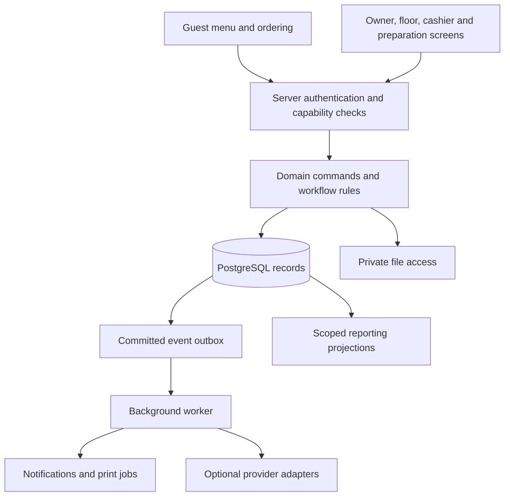
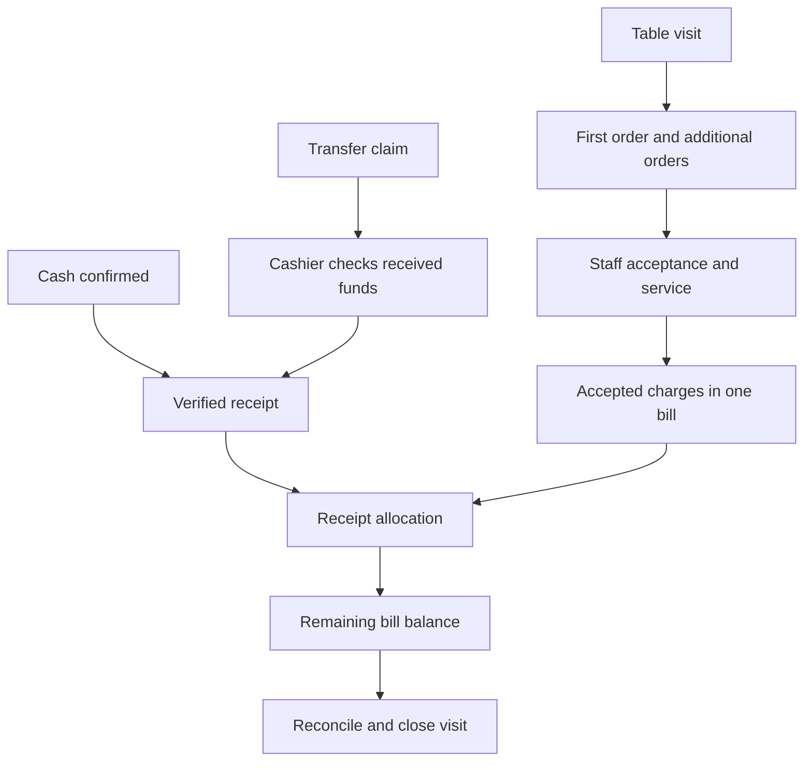
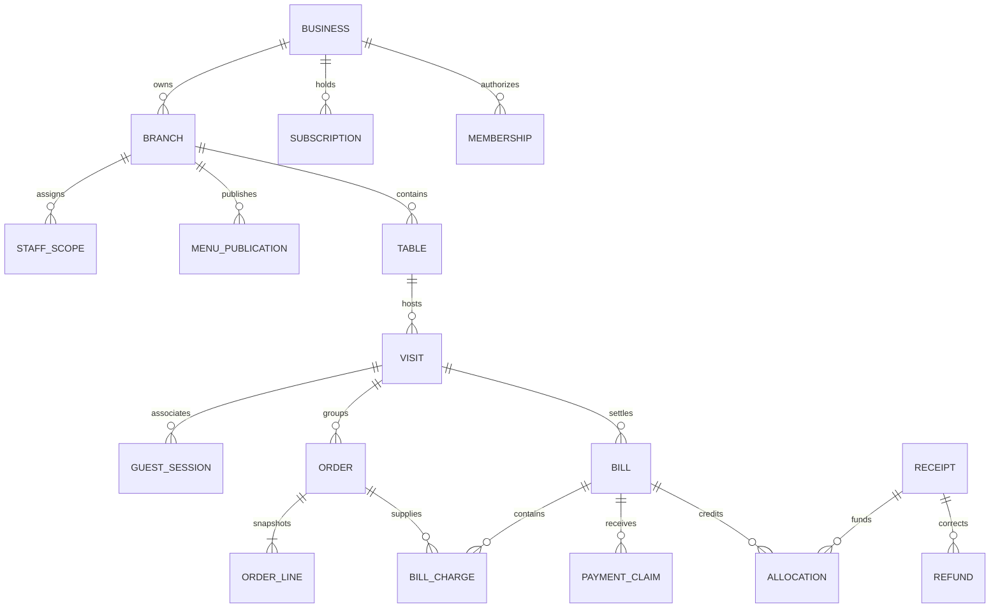

# MenuMini / MenuPro: system and workflow orchestration

**18 October priority/scope note:** [Project reassessment](project-reassessment.md) now governs the build sequence: menu creation, preview, publication and browsing first. The operating models and tier defaults below remain candidate designs or implementation history where not directly confirmed by the user. Do not treat their presence in SQL or this document as approval of a normal guest workflow. Consult [PRODUCT.md](../PRODUCT.md) for confirmed constraints and the reassessment for unresolved choices.

Design and implementation direction, 15 October 2026. This document coordinates the complete operating target. The workflow migrations and v2 contract represent visits, combined bills, receipt allocations, plan capacity and branch permissions. Private staff-service adapters now connect tables, staff-only visits, priced requests, unpaid acceptance, preparation and serving. [Workflow foundation](workflow-foundation.md) distinguishes tested behavior from pending authentication, guest access, real settlement procedures, reporting and integration work. This document does not claim all target modules work.

## 1. Decisions already selected and decisions still open

Selected direction: SvelteKit + TypeScript + PostgreSQL; Free / MenuMini / MenuPro; a maximum of two active branches for MenuMini, with a quoted price increase for branch two that keeps the plan as MenuMini; staff may accept orders while payment is pending; transfers initially require authenticated manual verification. The user has confirmed there is no pilot yet.

Recommended operating defaults: both guest QR ordering and staff-assisted ordering; staff acceptance before preparation; one combined bill per table visit in Mini; separate guest access to individual orders; cash and manually verified transfers; a supervised staff queue as the primary notification channel. These defaults are encoded in the local workflow foundation and remain subject to real workflow evidence.

Open commercial/operational choices include exact prices and the second-branch increase, item/image/staff limits, Pro branch capacity, subscription grace periods, authentication/recovery channels, receipt retention, hardware/POS compatibility, hosting budget, and the first pilot's service style. A technical possibility does not automatically become a promised plan feature.

## 2. The product structure

One product has different plans and operating modes. The plan decides which capabilities a business may activate; a staff member's permissions decide which actions that person may perform; venue configuration decides how enabled capabilities operate. These are three separate checks.

```text
User identity
  -> business membership and permissions
     -> business account + subscription + effective capabilities
        -> branch
           -> menu drafts, publications and live availability
           -> staff assignments, service settings and receiving accounts
           -> tables / service points
              -> table visits
                 -> guest sessions and staff-created orders
                 -> accepted charges and bill
                    -> payment claims
                    -> verified receipts and allocations
                    -> recorded refunds and reconciliation
```

A branch is a physical outlet. A table is a service location. A visit is one seating/use of that location. A guest session identifies one browser's permitted actions. An order is one submission, possibly followed by additional orders. A bill groups chargeable items for settlement. A receipt records actual funds received, and allocations specify which bill amounts those funds settle. These concepts must not be collapsed into the same ID.

The same person may belong to separate businesses; login does not combine their records. Free allows one active branch. MenuMini has a hard ceiling of two active branches: its base term has one; a requested, quoted, owner-accepted and billing-activated increase enables the second without switching plans. Pro capacity is a server-enforced contractual limit to be decided. Counting and creating branches must be concurrency-safe.

## 3. Plan capabilities

| Capability | Free | MenuMini | MenuPro target |
|---|---|---|---|
| Editable public menu, English/Amharic, ETB, availability, QR/link | Yes | Yes | Yes |
| Active branches | 1 | Maximum 2; quoted price increase for branch two | Contractual capacity; number open |
| Guest and staff-assisted orders | Browsing only | Both proposed | Both |
| Responsible staff queue and service status | No order operation | Simple branch workflow | Expanded station/role workflow |
| Table visit, repeated orders, combined bill | No | Basic combined bill | Advanced table/seat operations |
| Cash/manual-transfer receipts and unpaid balances | No | Yes | Yes |
| Basic daily close and exports | Basic menu usage only | Actual order/settlement records | Branch/group operational reporting |
| Multiple kitchen/bar stations and task routing | No | Simple handoff | Proposed |
| Advanced seat splitting, table merging/transfers | No | Staff-resolved exceptions initially | Proposed |
| Ingredient inventory, recipes, wastage, purchasing | No | Availability control only | Separate proven module |
| Automatic provider payment/POS connections | No | Possible later adapter | Possible adapter; not automatically available |
| AI assistance, media packages, physical printing | Usage/eligibility to decide | Optional | Optional |

Basic security, correct totals, accessibility, export of a business's own records, and protection of customer information apply across plans. Every command checks effective capabilities on the server. Hiding a button alone does not enforce a plan.

Upgrading keeps the business, branch, URLs and historical records. A downgrade must account for excess branches and active service. Preserve historic records and provide an explicit effective date; do not silently delete branches or disable settlement of existing bills. The final grace/read-only behavior is a commercial decision still open.

## 4. People, authority and surfaces

Role names below describe permission bundles. The workflow schema adds one bundle per person per branch; Manager combines the branch operating permissions. Owner alone grants assignments in this version. More flexible multi-bundle delegation remains future work; real authenticated operation is still pending.

| Actor | Main surface | Authority and boundary |
|---|---|---|
| Guest | Menu, item details, cart, own order status; authorized bill/payment link when needed | Browse without an account; submit permitted requests; see own order information; submit a claim. Cannot set authoritative prices or paid status. |
| Waiter / floor operator | Tables/visits, incoming requests, staff order entry, service status | Confirm table context, create orders for guests, accept within assigned permissions, record service. Payment verification is a separate permission. |
| Kitchen / bar / barista | Accepted work queue; Pro station tasks | Read preparation details for assigned work and report progress. No subscription, receiving-account or financial-edit authority. |
| Cashier | Bills, claims, cash receipts, verified transfers, shift close | Record real money and allocations; see relevant verification evidence. Refund permission is separately granted. |
| Manager | Branch overview, corrections, availability, staff assignments, reconciliation | Approve sensitive adjustments and resolve exceptions within assigned branches. |
| Owner | Business settings, menus, staff, receiving accounts, subscription, reports | Manage the business and delegate permissions; changes affecting money or access are recorded. |
| Platform operator/support | Subscription administration, operational incidents, authorized support cases | Operate the platform and its own billing. Access to restaurant data is scoped, justified and audited; support cannot casually mark restaurant bills paid. |

UI areas follow these responsibilities: guest menu/order experience; owner administration; floor/order queue; cashier/bill view; optional station display; platform administration. They use shared services and records, rather than independent copies of the same orders.

## 5. Technical composition and function ownership

The selected initial architecture is a modular SvelteKit application, PostgreSQL, and a background worker using committed events. Private file storage and external adapters are introduced with their respective functions. The stack supports server routes and server-handled forms; implementation must match the repository's installed SvelteKit version rather than copying newer-version examples blindly. See [SvelteKit routing](https://svelte.dev/docs/kit/routing) and [form actions](https://svelte.dev/docs/kit/form-actions).



| Module | Owns | Examples of commands and outputs |
|---|---|---|
| Identity/access | Login, sessions, membership, permission grants | Sign in/out, revoke session, grant branch scope; authenticated principal |
| Plans/subscriptions | Our software subscription and effective capabilities | Start/change/renew plan, apply capacity; capability decision |
| Business/branch | Business profile, branch lifecycle, settings | Create branch, set ordering mode, pause service; branch configuration |
| Catalog/publication | Menu drafts, validated publications, live availability | Save draft, publish, mark sold out; public menu projection |
| Dining/visits | Tables, QR context, active seating, guest capabilities | Open/close visit, resolve QR, link a guest safely; visit context |
| Orders | Guest/staff submission, immutable price/option facts, acceptance | Submit/accept/cancel/complete order; durable order and status event |
| Fulfillment | Preparation and service; optional station tasks | Route accepted work, mark ready/served; work queue |
| Bills | Accepted charges, adjustments, finalization and balance | Add charges, request bill, finalize/revise; explicit bill version |
| Restaurant payments | Claims, verified receipts, allocations, refund evidence | Submit claim, record receipt, allocate, record executed refund; balances |
| Reporting/close | Order, settlement and shift projections | Daily summary, count cash, close/reconcile, export; recorded discrepancies |
| Media/AI/printing | Assets, reviewed suggestions, fulfillment requests | Upload privately, propose draft content, quote/produce print job |
| Reliability/support | Outbox processing, adapter attempts, incidents and audit | Retry permitted side effect, inspect failure, recover; traceable outcome |

A typical command resolves the actor and scope, checks plan and permission, validates inputs and current versions, performs a short transaction, commits business records plus audit/outbox events, then returns the saved result. External network calls occur outside database locks. Notifications do not determine whether the order exists. PostgreSQL constraints and locking support integrity and serialized conflicting changes; see [constraints](https://www.postgresql.org/docs/18/ddl-constraints.html) and [locking](https://www.postgresql.org/docs/18/explicit-locking.html).

## 6. The operating workflows

### W1 — Business setup and plan activation

Business/owner/manager details -> verify the registrant's own phone -> establish owner authority or obtain owner approval -> first branch -> plan -> menu draft and preview -> publish -> prepare ordering/staff/payment responsibilities -> test and activate service. The owner may also be the manager, and both emails stay optional. Returning sign-in asks for the person's own phone and code, not the business profile again. [Business registration and setup](onboarding-workflow.md) specifies fields, role paths, recovery and each subsequent stage, and distinguishes the implemented validation preview from pending authentication/persistence.

Free publication does not need a bank account. Ordering is activated only when the venue has enabled staff handling. Receiving-account ownership is checked before that account is offered for settlement. Publishing a menu does not establish verified business ownership, food safety or bank verification; badges must describe only the check actually completed.

Our subscription invoices/payments belong to the platform billing module. A restaurant guest's payment for food belongs to restaurant payments. Paying a bill cannot unlock a software subscription, and renewing Mini cannot settle a guest's food bill.

### W2 — Menu editing, publication and availability

Owner/editor changes a draft -> validation -> preview -> explicit publish -> immutable publication/version -> public projection updates. Committed orders retain their original names, options and prices.

Operational sold-out/pause controls need a separate availability state so an urgent sold-out change does not publish unrelated unfinished price edits. The public response combines a publication version and availability revision. Submission checks the current permitted offer and availability; an outdated price or unavailable item returns a visible conflict for confirmation. The availability overlay is represented and tested in PostgreSQL and the public customer projection. Authenticated operational availability controls remain pending.

Templates provide starting sections, styling and supported options. Template feature names do not activate unimplemented inventory, calculators or legal checks. AI-generated content remains a draft until a responsible person reviews it.

### W3 — Table context and guest access

Staff opens/confirms a table visit -> guests scan the table QR -> server resolves business/branch/table -> branch mode and availability are checked -> a scoped guest session is established -> the browser obtains its permitted visit/order context.

A permanent table QR identifies a service point; it does not prove physical presence or grant access to every guest's order or the group's bill. Guest-to-visit association needs a safe confirmation/pairing policy. By default guests see their own orders; staff can provide a limited bill/payment link to an authorized payer. The next seating must not inherit the previous guests' private data.

Free supports browsing. A shared public menu link without table context supports browsing; placing a dine-in order requires confirmed context. Counter/takeaway flows can use explicit staff-confirmed service points when designed. Hotel room service and delivery introduce different context and integration requirements and remain later possibilities.

### W4 — Guest and staff-assisted orders

Both modes reach the same order service:

- Guest chooses items/options -> server quote/version check -> submit with a stable retry key -> committed SUBMITTED order -> own status screen.
- Staff selects visit/service point -> enters the guest's choices -> the same pricing/validation rules -> committed order recording the responsible staff actor and source.

The client cannot supply authoritative totals, paid status or merchant identity. A response lost after commit is an uncertain submission until the same request is resolved; retry returns the original order. A different payload with the same key is a conflict. A saved offline cart remains explicitly unsent.

The workflow schema distinguishes staff-origin orders from guest-origin orders, with the responsible staff actor or paired guest session recorded explicitly. Both paths use the same publication-based pricing command.

### W5 — Acceptance, preparation and serving

Responsible staff reviews SUBMITTED -> accepts or cancels -> accepted work goes to preparation -> ready -> served/completed. Counter service may use the explicit accepted-to-completed shortcut. Acceptance can happen while payment is unpaid, as selected by the user.

For Mini, a simple supervised queue and human kitchen handoff are sufficient possibilities. Pro can create station tasks for kitchen/bar/barista; overall progress reflects required task completion. A background notification or printed ticket cannot by itself establish that a human accepted or prepared the order.

Changes after submission need controlled correction behavior. Keep original price/order facts; use recorded cancellation/replacement or charge adjustments with reasons. If preparation has begun, involve the responsible staff and kitchen before confirming cancellation. A financial refund remains a separate action.

### W6 — Visit, bill and additional rounds

A table visit groups its accepted charges. Additional coffees or drinks create additional orders associated with the same visit; each uses its applicable published prices. The bill references immutable accepted charges and explicit authorized adjustments. Submitted but unaccepted requests are not silently billed.

The target Mini default is one combined bill per visit. Basic repeated orders and settlement of the combined bill are required for ordinary dine-in operation; advanced seat splits and table merging are separate Pro possibilities. Multiple payers can make receipts allocated to the same bill without exposing each other's private order details.

Cashier/authorized staff requests or finalizes the bill -> checks its version and unresolved requests -> sets final charge amounts -> provides permitted payer access -> receives/allocates funds -> reconciles -> financially closes the bill when its obligations are resolved. Ending a seating and declaring funds received are distinct operations. An unpaid departure is an exception to record and resolve, not a successful paid close.

Physical table release is separate from financial closure. Staff can end the seating and make the table available while a bill, claim or refund remains unresolved; those obligations stay visible for follow-up. Ending the visit stops new orders against that seating, while appropriately scoped history/payment access follows its explicit expiry/recovery policy. A new seating gets a new visit.

Accepted new orders and bill finalization must serialize. Finalization freezes the charge set; another round requires an explicit revision/reopen or new bill under the defined policy. Earlier revisions and payment facts remain preserved. Calculation uses one canonical rule for charges, discounts, taxes and service fees, avoiding duplicated charges across orders and bills. Applicable receipt/fiscal treatment needs the venue's real procedure before release.

### W7 — Cash, transfers, discrepancies and refunds

Customer chooses payment -> pays the restaurant through the selected method -> cash is confirmed or a transfer claim is submitted -> authorized cashier checks actual received funds -> records the receipt once -> allocations settle bill amounts -> balances are derived -> the payer gets an acknowledgment appropriate to the actual verification.

Claims and screenshots are evidence for review, not receipts. Duplicate canonical provider/recipient/reference combinations cannot become a second receipt. One verified transfer can settle charges from several orders through the bill without copying its bank reference into multiple invented receipts.

Record the actual credited amount separately from its allocation. A partial receipt leaves a balance. An overpayment has an explicit unapplied amount requiring resolution; do not silently change the credited amount to fit the bill. For cash, distinguish tendered cash, returned change and net receipt so revenue is not inflated by cash handed over temporarily. Required workflow support and its UI must be defined before advertising mixed/partial settlement.

A requested refund is pending; a refund is recorded as executed only with the appropriate actor and evidence of the real action. Allocations/refund effects must remain consistent with the original receipt and bill. Cancellation can create a refund obligation for a prepaid order. The application records these obligations and actions; it does not automatically move funds in the manual version.

Financial invariants: the receipt's original received amount equals its net allocated amount plus remaining unapplied amount plus executed refunds. Allocation reversals and charge credits are explicit linked records. Refunds of previously billed items require the associated authorized charge correction; a refund of unapplied excess does not reduce the food charge. Never rewrite a historic receipt or silently remove a billed item to make totals agree.

If funds arrive before order acceptance, record the actual receipt and its pending/unapplied disposition. Acceptance can then establish charges and their allocations; rejection preserves any refund obligation. Display funds received awaiting acceptance rather than inventing a completed food sale. A zero-charge bill uses NO_PAYMENT_DUE and still displays any unapplied/refund obligation separately.



### W8 — Shift close and owner reporting

Cashier reviews completed/open orders, billed charges, verified receipts, outstanding/unapplied amounts and executed refunds -> counts cash -> compares expected net cash with actual -> records differences and reasons -> closes the shift -> owner reviews the result.

Open visits and unpaid amounts carry forward visibly. Local reporting dates use Africa/Addis_Ababa and an explicit shift/closing boundary. Later corrections append evidence and change the relevant projections without rewriting a historical closing record. Sales, received money, accounts outstanding, fees and profit are different measures; profit reporting needs reliable cost data.

### W9 — Subscription renewal, upgrade and downgrade

Owner requests/renews a plan -> our billing process verifies our own subscription payment -> effective dates/capacities are recorded -> capabilities become available -> branch creation and operations enforce them.

Pro upgrades preserve existing branch records; extra branches receive explicit scoped staff assignments. A downgrade with excess branches requires selection and scheduled transition. Subscription expiry has an agreed grace/fallback policy, with outstanding bills and exports still handled safely. No precise grace period or permanent-free resource limits have been approved.

### W10 — AI, media, QR production and physical printing

AI/photo import -> proposed draft -> owner review -> normal validation/publication. AI never accepts orders, verifies bank credit, changes permissions, or labels ingredient safety as established fact.

Menu photos can have public derived assets; original uploads and receipt evidence need their appropriate private policies. QR artwork encodes a stable route or revocable table capability and is tested at its actual printed size. Owner downloads/reprints remain distinct from buying physical stands.

Physical print request -> saved request -> explicit quote -> owner acceptance -> recorded payment if applicable -> production -> dispatch -> delivery evidence. A toast or opened messaging app does not complete this workflow. Artwork, item quantity, shipping address, recipient and fulfillment history are protected records.

## 7. Independent states and authority

| Record | Proposed state/result model | Who can establish it |
|---|---|---|
| Browser cart/submission | DRAFT / SENDING / UNCERTAIN / ACKNOWLEDGED | Client display reflects durable server evidence; offline draft has no order acknowledgment |
| Order service | SUBMITTED -> ACCEPTED -> PREPARING -> READY -> COMPLETED; permitted CANCELLED paths and simple-service shortcut | Authorized staff/domain rules |
| Transfer claim | SUBMITTED -> APPROVED or REJECTED | Permitted verifier; approval links to actual receipt evidence |
| Bill structure | OPEN -> FINALIZED -> CLOSED; explicit revision/reopen policy | Staff/cashier/manager within assigned permission |
| Table visit | OPEN -> ENDED; ending releases the service point without concealing outstanding money obligations | Responsible staff; another seating uses another visit |
| Bill settlement | UNPAID / PARTIALLY_PAID / PAID / NO_PAYMENT_DUE; refund and unapplied obligations displayed separately | Derived from charges, verified receipts, allocations and executed refunds |
| Refund operation | REQUESTED / APPROVED / EXECUTED or REJECTED | Authorized approval and evidence of execution; pending request does not establish money returned |
| Subscription | Free or paid plan with explicit trial/active/grace/expired effective state | Platform billing authority |
| Background attempt | PENDING / RUNNING / SUCCEEDED / RETRY_DUE / FAILED | Worker and actual adapter evidence |

The current order-state names are retained. The workflow migration and v2 contract formalize the initial visit, bill, subscription-term and refund rules; expanded workflows remain separate work. “Food served,” “bill finalized,” “claim submitted,” “funds received,” and “money returned” are independent facts. Database records are authoritative for application state; external credited funds still need trustworthy verification.

## 8. Data target and required revisions



This is a conceptual target. Required relationships must be mandatory where appropriate in the final physical schema; diagram cardinalities are not a substitute for constraints or access rules. Initially, a visit has one active bill; multiple bills are an explicit advanced workflow. Bill-charge mappings must prevent charging the same accepted item twice unless an explicit quantity allocation/split is defined.

The original foundation contained identity/membership, merchants/venues, catalog/publication, table/guest sessions, orders/events, receiving accounts, an order-linked ledger, outbox/audit. The workflow migration now represents the first six revisions below; shift/station/integration modules remain future work:

- Plan/subscription history, capability/capacity enforcement and concurrency-safe branch limits. Replace the unconditional one-venue index with an appropriate plan-aware mechanism when Pro is implemented; do not simply remove all Mini limits.
- Branch-scoped permissions and staff order actor/source, beyond the current OWNER / OPERATOR and mandatory guest-session link.
- Separate table visits, safe guest association and closure/recovery rules.
- Bills, immutable charge mappings/adjustments, versions and finalization rules.
- Canonical receipts, allocations and refund obligations; migrate order-linked settlement semantics carefully rather than duplicating one transfer across orders.
- Live availability revision/override, independent of unpublished menu price drafts.
- Shift close/reconciliation records; optional stations, media/AI/print job and provider-attempt records as their functions become real.

All operational links remain business/branch scoped. Exact money and currency are checked consistently. Updates to capacity, accepted charges, allocations and refunds need short, correctly ordered locks to reject concurrent conflicting work. Identity, private evidence, public menu projections, audit history and archival behavior retain distinct access policies.

The original foundation migration remains intact. A separate workflow migration adds the visit/bill model and retires runtime access to its order-linked settlement path. Current database and contract evidence is recorded in [workflow foundation](workflow-foundation.md); the earlier 37 checks cover only the v1 baseline.

## 9. Events, integrations and failure handling

Committed domain events drive optional side effects. Examples are menu.published, availability.changed, order.submitted, order.accepted, order.ready, bill.finalized, receipt.recorded, payment.allocated, refund.executed, shift.closed, subscription.changed and print.requested. Each event has a stable identity and scoped records. Workers are duplicate-tolerant; an external failure leaves the core record intact and an explicit retry/failure state.

| Possibility | Intended use | Activation requirement |
|---|---|---|
| Browser staff queue and status polling | Primary supervised operations | Real-device visibility, reconnect behavior and staff responsibility verified |
| Telegram/other notification adapter | Secondary notice of saved work | Merchant authorization, protected destination, credentials and actual send outcome; delivery to a channel is not human acknowledgment |
| WhatsApp draft handoff | Owner/customer convenience | Clearly label opened draft; no delivery assertion |
| Chapa or telebirr payment adapter | Future provider-confirmed receipts | Merchant onboarding, real credentials, server verification, amount/reference matching, duplicate/reversal handling, end-to-end testing |
| Printer / existing POS connector | Kitchen ticket or existing register handoff | Supported models/interfaces, network/power behavior, duplicate/reprint rules and fiscal compatibility |
| AI import/copy assistance | Reduce menu-entry effort | Bounded usage, private credentials, validation and human review |
| Private object storage | Receipt evidence and protected originals | Upload validation, ownership checks, retention and signed/scoped reads |
| Inventory / station / hotel / delivery modules | More complex operations | Specific customer workflow, complete data/contracts, adapter proof and support economics |

Chapa explicitly calls for checking webhook origin, re-querying transaction details before granting value, and idempotent processing; apply those requirements if that adapter is selected. [Chapa webhooks](https://developer.chapa.co/integrations/webhooks). Telebirr's portal documents merchant integration and test tools, but that does not establish our access or integration readiness. [Telebirr developer portal](https://developer.ethiotelecom.et/user/product).

| Failure/exception | Required visible outcome |
|---|---|
| Connection disappears before submission | Saved cart marked unsent |
| Response disappears after submission | Uncertain; resolve original retry key before creating a new order |
| Price/menu changes or item becomes unavailable | Updated offer and explicit reconfirmation; no silent substitution |
| Wrong/expired QR or wrong visit | Browse/failure or new confirmed context; no unrelated bill access |
| Staff device misses a notification | Durable queue remains the source; responsible staff catches pending work |
| Kitchen cannot fulfill accepted work | Authorized correction, guest communication and financial obligation handled separately |
| Transfer unverified or wrong amount | Pending/discrepancy and remaining/unapplied balance; no automatic paid badge |
| Same receipt/review retried or two cashiers act together | One canonical recorded receipt/allocation, or version conflict |
| Provider callback delayed, repeated or reversed | Verify/reconcile, deduplicate and append correction; no fabricated settlement |
| Subscription changes during service | Explicit effective policy; existing obligations can still be resolved |
| Application/worker restarts | Durable orders, bills, money records and retry state recover |
| Power/network prevents operations | Staff fallback and later reconciliation; do not promise offline-confirmed cloud orders |

## 10. Contracts, scenarios and implementation dependencies

Document contracts around these domains before implementing them. Existing menu/order/payment contracts are a starting point; bill-based settlement changes their resources and invariants. Required families are identity/setup, memberships/scopes, subscriptions/capabilities, draft/publication/availability, table visits/guest association, guest/staff orders, fulfillment, bill charges/finalization/access, claims/receipts/allocations/refunds, shift/reporting, optional integrations/jobs and support/audit.

Each command contract records actor and capability, allowed state, authoritative inputs, expected version/retry key, transaction result, emitted event and failure behavior. Use fictional examples; distinguish draft contracts from live endpoints. Keep OpenAPI/Postman artifacts synchronized after model revisions, rather than leaving old order-only examples labeled as the bill workflow.

Walk through these scenarios before connecting the UI:

1. Free publishes a usable menu and cannot bypass order restrictions through a direct request.
2. Mini cannot create branch two without the accepted quote and verified capacity activation, or any third active branch, including concurrent creation.
3. Guest order and staff-assisted order follow the same price/availability rules.
4. Two guests at one table retain private order access while staff aggregate the visit bill.
5. A second seating cannot access the first visit's orders/bill.
6. An additional round creates another order and the correct combined bill.
7. An additional order races bill finalization and receives a controlled result.
8. One bank transfer settles a combined bill containing multiple orders exactly once.
9. Cash, partial transfer, overpayment/change and pending refund have truthful balances.
10. A cancelled prepaid order retains its refund obligation.
11. Staff permission revocation and cross-branch/cross-business access are enforced.
12. A sold-out toggle does not publish an unfinished draft price change.
13. Subscription change/downgrade preserves outstanding service/financial records under the explicit policy.
14. Notification/print/provider retries and restarts cannot create duplicate business facts.
15. Daily close differentiates sales, actual receipts, refunds, unpaid/unapplied money and cash discrepancies.

Implementation follows dependencies: identity + capabilities + business scope -> catalog/publication and dining context -> orders/fulfillment and bill rules -> receipts/allocations/reconciliation -> optional adapters and advanced Pro modules. Reliability and access controls apply at every step. Field evidence is still required before commercial readiness claims.

## 11. Immediate output of this design stage

The complete structure, workflow responsibilities, tier possibilities and exception map are reviewable together. Visit/bill, permission and capacity rules have a physical model, v2 contracts and isolated verification. OTP is deferred: the preparation flow builds and exports/imports a first-branch/menu draft with verification pending. Persistent menu/profile commands, safe customer HTTP reading and a local QR have isolated fictional evidence. Merchant preparation connects branch/menu editing, options, service duties and readiness review. Staff table/visit/order adapters and floor/preparation screens now follow that foundation; a separate fictional rehearsal demonstrates the interface without identity or live business writes. Cashier bill handling and manual-settlement interfaces are now implemented behind locked verified access, including outstanding bills from ended seatings. The connected rehearsal uses fictional browser memory only. Guest pairing/token issuance and own-order tracking now have limited cookie-based HTTP/DB adapters and guest A/B views in the shared rehearsal; see [guest-ordering-design.md](guest-ordering-design.md). Separate payer authorization, private shared bills and already-sent transfer reports now connect to the existing cashier verification and allocation workflow; see [payer-claims-design.md](payer-claims-design.md). Supported guest/payer/service/cashier commands now have encrypted reload recovery, original-key status and serialized cancellation; see [command-recovery-design.md](command-recovery-design.md). Real receiving-account/settlement procedures, authenticated merchant browser acceptance and supervised reconciliation remain before activation. Real business access and publication need trusted identity/business setup and the owner-to-guest checks in the [build sequence](build-sequence.md). Unimplemented advanced modules remain target possibilities.
