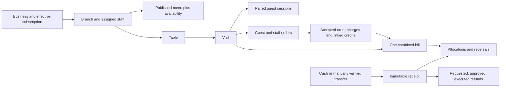

# Workflow foundation: implementation and verification

**18 October sequence update:** preserve the implementation evidence below, but follow [project reassessment](project-reassessment.md) for next work. The user selected menu creation, preview, publication and browsing before further cart/settlement/receiving-account expansion. Existing test counts do not establish acceptance of the replacement UI or all operating defaults.

15 October 2026. This is the current implementation record for the operating model in [system-orchestration.md](system-orchestration.md). Registration and preparation validation, branch/plan/menu preparation and portable draft recovery exist. Persistent menu/profile/service commands and immutable publication have isolated database evidence. Staff table administration, staff-only visits, server-priced orders, unpaid acceptance, preparation and serving now have private adapters and operating screens. These adapters are tested with trusted fictional principals; the actual HTTP identity adapter remains closed. A separate browser rehearsal demonstrates the staff interface using fictional memory only. The customer menu reads PostgreSQL publications through HTTP and generates its QR. Private cashier adapters and a cashier/manager interface now cover bill worklists, explicit receipts/allocations, claims, credits, refunds and closure. OTP is deferred by the user. Guest sessions and own-order tracking now have isolated cookie/HTTP/DB acceptance and a connected fictional rehearsal. Real accounts, authenticated business operations, production capability configuration/delivery, receiving-account procedures, device acceptance and release remain pending.

## Structure now represented in PostgreSQL

Apply migrations `0001_foundation.sql` through `0008_cashier_settlement.sql` in order only to a reviewed fresh foundation. The second migration deliberately rejects existing orders or legacy payment history; conversion of populated v1 records requires its own reviewed migration. Migration 0007 requires table labels to be unique after trimming, Unicode normalization and case folding; ambiguous existing labels need review first. The isolated checker uses a new private PostgreSQL cluster, disables TCP listening, and never connects through `DATABASE_URL`.

Migration 0002 adds 16 tables and extends the earlier foundation. Migration 0003 adds Mini branch-price quotes and consent-linked capacity activation; 0004 makes email optional and adds canonical phone identity fields. Legacy order-linked payment tables remain for schema history, with application access revoked. The receipt/allocation model is the current target. Do not run both settlement paths against the same business.

## Rules encoded for this initial implementation

| Concern | Implemented rule |
|---|---|
| Plan and branch capacity | Free: one active physical branch. MenuMini: a hard maximum of two; base capacity one, then request → quote → owner price acceptance → verified billing activation for branch two, staying on Mini. Pro: an explicit applied capacity; 2–1,000 is a technical guard, not an approved commercial maximum. Branch creation locks the business before counting. |
| Subscription authority | Only a separately authenticated platform billing actor can apply a term. Restaurant receipts cannot activate software access. Terms are immutable and the business references its effective term explicitly. |
| Expiry and downgrade | Expiry prevents new seating/orders. Assigned staff retain access to existing service and financial obligations. Downgrade is rejected while active branches exceed the new capacity. No commercial grace period is assumed. |
| Staff | Owner grants one role bundle per person per branch. Manager combines branch operating permissions; waiter, cashier, preparation and editor have narrower bundles. Owner alone assigns staff in this version. Multi-bundle grants are future work. |
| Seating | One open visit per table. Ending a visit requires outstanding service to be resolved, but does not require financial closure. A new seating receives a new visit and new guest context. |
| Guest access | Public table QR establishes context only. A private visit token associates a valid browser session. Guests read only their own orders; combined bill access needs a separate staff-issued grant bound to that guest and visit. Revoked/expired sessions lose access. |
| Orders and prices | Staff and guests use the same publication-based pricing. Draft prices cannot affect current orders. Required/invalid modifiers and unavailable items are rejected. A live availability override does not publish draft edits. Pricing policy must be explicitly confirmed; fixtures use illustrative zero tax/service, not a legal default. |
| Bill | One bill per visit. Only accepted orders add charges. Finalization rejects unresolved submitted requests and stops further orders. Mini does not yet offer a general reopen, seat split, merge or table-transfer command. |
| Corrections | A credit identifies its accepted order and cannot exceed its remaining charge. Cancellation credits only what remains after earlier credits. Excess allocations are reversed explicitly; original receipts stay unchanged. |
| Money | Exact ETB values and decimal-string API amounts. Actual funds received are separate from allocations. Partial funds leave an outstanding balance; excess funds remain unapplied. Cash records tender, returned change and net receipt. |
| Transfer verification | A claim or screenshot never establishes payment. Authorized staff record actual credited funds. Provider/recipient/reference identity is unique across businesses. Provider-specific account/reference normalization and ownership onboarding remain required before real use. |
| Refund | Request reserves unapplied funds; approval does not assert execution. Only an authorized execution record changes refunded funds. Manual commands record evidence of the real action and do not move money. |
| Closure | A bill closes only after service, outstanding balance, unapplied funds and pending refunds are resolved. A late receipt or correction reopens financial resolution and preserves the earlier close event. |
| Financial identity | Received amount = net allocated amount + unapplied amount + executed refunds. Negative balances, excess order credits and public money-precision overflow are rejected. |
| Integrity | Monetary facts, audit events and outbox records commit together. Conflicting branch commands serialize. The runtime cannot directly edit financial facts or use the retired ledger. |

Branch serialization deliberately favors clear lock ordering over maximum throughput. No network call belongs inside these transactions. Real workload measurements are required before narrowing locks or making performance promises.

The database role is server-only. Trusted middleware must verify sessions/tokens, then establish transaction-local actor/business/grant settings. A supplied UUID is never authentication. The private function owner has explicit RLS policies and cannot log in or bypass RLS; the interactive runtime has no platform-role membership. These boundaries do not substitute for implementing and testing HTTP authentication.

## Contract coverage and remaining work

`postman/specs/workflow-v2.openapi.yaml` defines 73 operations. Registration/setup/workspace validation and public-menu reading are four functional public HTTP handlers. Forty private catalog, preparation/readiness, staff-service, cashier and guest/payer-capability authorization boundaries reject access with 401 until trusted merchant identity is connected. Seventeen guest/payer handlers use a separate limited cookie-resolving connection; the other 12 operations remain target HTTP contracts. OTP is deferred by the user. Preparing or importing a draft, or using the fictional rehearsal, never creates identity, business access, billing or publication. The following table distinguishes underlying database support from the remaining service work.

| Contract operation(s) | Database support | Required service work |
|---|---|---|
| Public menu | `read_public_menu`, limited public role, real HTTP/SSR customer page and QR | Canonical production origin, hosting/device acceptance; legacy publications need validated republishing |
| Guest session, merchant context | Narrow `menu_guest_api` session-start and cookie-resolution entry, random client start nonce, hashed session/CSRF, expiry and revocation | Guest HTTP is verified on disposable fixtures; real merchant context/login/recovery and production configuration remain pending |
| Create branch | `create_branch` | Authenticated owner setup and response mapping |
| Assign branch staff | `assign_staff` | Stable replay handling and response mapping |
| Branch-profile and menu drafts, publication | `save_branch_profile`, `read_branch_profile`, `save_menu_draft`, `read_menu_draft`, `publish_menu`; immutable snapshots, routing and original-response retry records | Server command/response adapters are verified in-process with isolated fictional principals; real identity and authenticated editing/publication remain pending. Direct runtime writes remain revoked |
| Set availability | `set_availability` | Stable replay handling and response mapping |
| Administer tables and staff-only visits | Versioned table commands, `staff_service_command`, scoped table/visit projections and exact original-response retries | Private adapters and staff screens implemented; real identity and authenticated HTTP acceptance pending. No guest QR or pairing token is issued |
| Issue table links/visit invitations and pair guest | HMAC capability issuance with exact replay, five-minute invitations, hashed cookie resolution and own-table association | Limited server/DB/HTTP adapters and connected guest rehearsal implemented; verified merchant identity, production key/HTTPS and safe field delivery remain gates |
| Submit staff order, read/transition service work | `submit_workflow_order`, `transition_order`, reviewed pricing fingerprint, live availability and role-scoped paginated queue | Private adapters and floor/preparation screens implemented; real verified sessions and independent authenticated clients pending |
| Submit guest order, read own order | Publication/pricing fingerprint, strict guest commands, own-order read/list, expiry/revocation and durable original-response retries | Guest request and tracking screens implemented; isolated HTTP/DB and browser rehearsal evidence are separate from actual device/pilot acceptance |
| Read/finalize/credit/close bill | Narrow staff balance read plus private cashier worklist/detail and command adapters with original-response retries | Actual verified sessions; real cashier procedure and device acceptance |
| Issue/revoke payer grant, redeem and read shared bill | `payer_staff_command`, `payer_entry`, session-bound HMAC grants, HttpOnly bill cookie and private shared projections | Implemented locally with expiry/revocation, exact replay, limited cookie HTTP and fictional rehearsal; real merchant authorization and safe delivery pending |
| Submit/read own/review transfer claim | Narrow payer entry freezes the destination, serializes duplicate references and writes pending evidence; existing cashier receipt/allocation command remains financial truth | Local HTTP/DB and rehearsal implemented; private uploads, provider normalization and actual credited-funds procedure remain gates |
| Record/allocate receipt | Private `record_receipt`/`allocate_receipt` adapters and cashier forms; receipt acknowledgement and original-response retries | Recipient onboarding/reference canonicalization, real cash/bank evidence, supervised reconciliation and authenticated browser recovery acceptance before activation |
| Request/review/execute refund | Private command adapters and separate cashier request/manager review/actual-execution interface | Verified staff sessions and actual return evidence/procedure; commands never move funds |
| Request generic plan change, apply term | Request table, platform-only `apply_plan` | Generic owner request command, billing process, stable replay and platform authentication |
| Mini branch-two request, quote, acceptance, activation | `request_mini_branch`, `quote_mini_branch`, `accept_mini_branch_quote`, `activate_mini_branch_quote` | Authenticated endpoints, quote/invoice UI, current-price verification and actual billing reconciliation; prices remain undecided |
| Registration fields | Shared typed validator, actual 24-type registry, stateless validation HTTP endpoint | Phone verification, secure sessions, owner approval, invitations and persisted setup |
| Setup preparation validation | Shared strict branch/menu validator, actual section names for all 24 types, stateless HTTP endpoint | Persisted authenticated onboarding, pricing activation and menu publication; draft export/import is not account persistence |

Most operational commands persist exact-body idempotency records. Branch creation has its own capacity-locked retry identity. Assignment, availability and platform term application still require stable command replay handling before satisfying the HTTP contract. Table/invitation/payer issuance uses stable HMAC reconstruction on exact retry without storing plaintext secrets; this does not imply replay safety for the other target modules. Do not advertise universal retry safety before those wrappers are complete.

The v2 Postman collection is generated from the spec and then normalized with `scripts/prepare-workflow-collection.py`. Its 73 requests are independent fictional scenarios, with empty session variables, cookie/CSRF headers where appropriate and saved examples. The four public validation/menu operations, an eight-request guest workflow, a five-request payer workflow and four recovery requests have been executed locally; the closed merchant editing/service/issuance boundaries have separate negative HTTP checks. It is not an executable restaurant transaction acceptance flow until matching backend fixtures and authenticated sessions exist. No cloud workspace is linked or pushed.

Private service preparation and aggregate readiness do not activate tables, staff, payments or ordering. Remaining modules include business onboarding/authentication, production capability setup/delivery, receiving-account onboarding and supervised reconciliation, real settlement procedures, private uploads, daily/shift reconciliation and exports, a separate worker role/lease command, backup restoration, and optional integrations. The interactive runtime cannot read or mutate the outbox. Earlier v1 worker checks do not prove v2 worker operation. Pro inventory/stations, physical printing, automatic payments and advanced table billing remain future modules.

## Verification and next build dependency

Current results are saved in [workflow-db-validation.json](workflow-db-validation.json) and [workflow-contract-validation.json](workflow-contract-validation.json). The database suite includes actual overlapping connections for allocation, order/finalization and branch-capacity conflicts, plus a database restart. The contract suite validates saved requests/responses and four actual PostgreSQL bill/receipt projections. [validation.md](validation.md) lists reproducible commands and their limits.

The menu foundation passes persistent draft/publication, public HTTP and QR checks with isolated fictional principals; see [menu-publication-design.md](menu-publication-design.md). Menu/service preparation is connected in the workspace; see [merchant-workspace-design.md](merchant-workspace-design.md). Table/visit and staff order/service interfaces are now implemented behind the same closed identity boundary; see [staff-service-design.md](staff-service-design.md). Cashier bill/manual-settlement adapters and interfaces are now implemented behind that boundary; see [cashier-settlement-design.md](cashier-settlement-design.md). Guest pairing/token issuance and own-order tracking now have limited cookie-based server/DB/HTTP adapters and shared rehearsal views; see [guest-ordering-design.md](guest-ordering-design.md). Separate payer grants, shared bill projections and transfer reporting now have limited cookie HTTP/DB and shared rehearsal implementations; see [payer-claims-design.md](payer-claims-design.md). Supported guest, payer, staff and cashier commands now save an encrypted pending record before sending and resolve the original key after reload; see [command-recovery-design.md](command-recovery-design.md). Next implement receiving-account preparation and supervised verification/reconciliation while keeping real OTP/business access deferred. Real onboarding/publication, independent authenticated/guest clients and pilot evidence remain acceptance gates.

## Merchant workspace verification

Migration 0006 adds separate versioned service drafts and a manager/owner aggregate readiness projection. Prepared table labels and duties grant no access. Private commands check both orders.manage and payments.record, preventing waiter/editor/cashier escalation. Server responses use exact version and idempotency checks, bounded strict JSON, Origin/CSRF checks, parameterized SQL and transaction-local scope. The identity adapter currently returns no principal for every external request.

The existing workspace suite retains 90 passing server/DB checks and 31 HTTP checks. The full workflow database suite has 194 passing checks across eleven migrations. The current contract results and saved-example counts are recorded in [workflow-contract-validation.json](workflow-contract-validation.json). Each report records its own date and scope; browser/export/recovery evidence is separate. None establishes authenticated merchant HTTP or production launch.

## Staff service verification

Migration 0007 adds versioned owner table administration, staff-only visits and original-response retry records. Staff order submission includes the publication and reviewed pricing fingerprint; the database checks current availability and computes exact totals. Only accepted requests add charges. Preparation sees accepted/preparing/ready work; floor staff records serving. A resolved seating can end with its unpaid bill intact, and the next seating receives a separate visit and bill.

[staff-service-validation.json](staff-service-validation.json) records 75 passing actual server/DB checks, two overlapping-connection cases and restart recovery. [staff-service-http-validation.json](staff-service-http-validation.json) records 15 actual HTTP checks for closed private access, locked screens and rehearsal headers. Successful actions use trusted fictional principals in-process, never a browser identity bypass. The browser rehearsal changes memory only. See [validation.md](validation.md) for commands and independent evidence limits.

## Cashier settlement verification

Migration 0008 adds the paginated unresolved/closed bill worklist, restricted settlement detail, exact-money validation and original-response command wrappers. Ended seatings retain outstanding bills. Only active verified branch-linked receiving accounts appear, with masked labels. Cashier permissions cover receipt recording/allocation; credits and refund review/execution require manager permissions. Actual received/returned confirmations remain separate from claim submission and refund approval.

[cashier-settlement-validation.json](cashier-settlement-validation.json) records the actual private server/PostgreSQL checks, concurrent allocation/late-receipt races and restart durability. [cashier-http-validation.json](cashier-http-validation.json) checks that all 11 new private HTTP boundaries and the cashier page stay closed while real identity is deferred. The browser rehearsal shares fictional staff-to-cashier records in memory only. Authenticated recovery clients, real accounts/banks, fiscal treatment, reconciliation exports and pilot acceptance remain unverified.

## Interrupted command recovery

Migration 0011 and eight HTTP operations resolve supported original request keys with current authority. Encrypted IndexedDB writes precede supported mutations; reload restores the pending request without automatic delivery. Atomic insertion across tabs blocks a different replacement. Confirmed cancellation shares the branch lock with the original command and persists an immutable tombstone; committed records are never reversed. Guest/payer cookie HTTP is tested against disposable fixtures. Staff/cashier adapters are verified in-process and their externally reachable routes stay closed while real identity is deferred. See [command-recovery-design.md](command-recovery-design.md), [command-recovery-validation.json](command-recovery-validation.json), [command-recovery-http-validation.json](command-recovery-http-validation.json) and the separate browser report. Storage eviction, lost sessions and unsupported operations still require supervised reconciliation.
